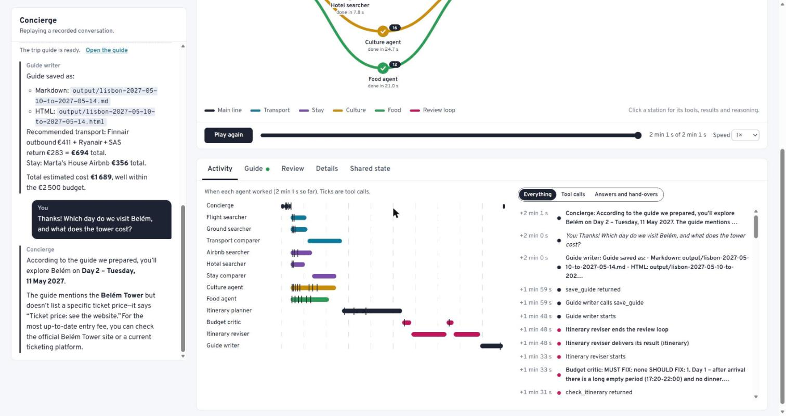
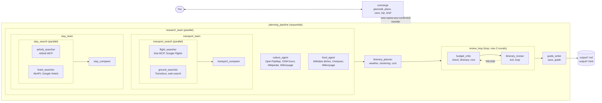

# Multi-Agent Travel Planner

Tell it where and when you want to travel. Thirteen AI agents then work together to produce a day-by-day trip
guide:

- they compare flights, ferries and trains, and Airbnb against hotels;
- they find sights with their history, local dishes and restaurants for your budget;
- they fit everything into a schedule that respects opening hours and the weather;
- a critic checks the result before you see it.

The planner never books anything. Every option comes with a link, and every price says where it came from.

Built with [Google ADK](https://google.github.io/adk-docs/) on GPT OSS 120B (University of Oulu Lehmus API) for the
AI Engineering course. See [PROJECT.md](PROJECT.md) for the specification and [PLAN.md](PLAN.md) for the build log
and decisions.


**Example request:** *"Plan 5 days in Lisbon for two, mid budget, we love history and street food."* About five
minutes later you get `output/lisbon-2027-05-10-to-2027-05-14.md` and `.html` with:

- the chosen flights and their alternatives;
- stays compared by neighbourhood;
- five planned days with short histories and food stops;
- the dishes to try;
- a cost table against your budget, with sources marked as *live* or *web estimate*.

---

## Quick start: the offline demo (no keys needed)

A complete Lisbon run is recorded in `cache/demo/`: every tool result and every model answer. With `DEMO=1`
the planner replays it exactly, so you can see the whole system without any accounts. After installing, it needs
no network either.

You need Python 3.11 or newer (developed on 3.13) and Git.

```bash
git clone <this repository> && cd Multi-Agent-Travel-Planner
python -m venv .venv
.venv/Scripts/pip install -r requirements.txt     # macOS/Linux: .venv/bin/pip
```

Then pick one of three ways to watch it:

| How | Command | What you see |
|---|---|---|
| Terminal | `.venv/Scripts/python scripts/run_trip.py --demo` | The conversation, every tool call, an agent timeline and the quality checks, in about 3 s |
| ADK web | `DEMO=1 .venv/Scripts/adk web`, then pick `travel_planner` | ADK's chat UI with the full event trace |
| Web UI | see [below](#the-web-ui) | The animated agent map, inspector, timeline and guide |

In `adk web` and the web UI, type (or click) exactly these four messages, because the replay only knows the
recorded conversation:

1. `Plan 5 days in Lisbon for two, mid budget, we love history and street food.`
2. `We fly from Helsinki, 10-14 May. Total budget about 2500 euros.`
3. `Yes, that's right, go ahead.`
4. `Thanks! Which day do we visit Belém, and what does the tower cost?`

In PowerShell, set variables first: `$env:DEMO="1"; .venv\Scripts\adk web`. Add `DEMO_PACE=0.2` to replay the
model answers at a realistic speed (about 2 minutes for the whole run) instead of instantly.

## The web UI

A React front end in [`travel-planner-ui/`](travel-planner-ui/README.md):

- **Chat** with the concierge.
- **Route map:** the agent tree drawn as a transit map. Stations light up while agents think, tool calls rise
  out of them as chips, and the review loop counts its rounds.
- **Inspector:** click any agent or tool call for its arguments, results and reasoning.
- **Activity:** a Gantt chart of who worked when.
- **Guide:** the rendered guide with downloads.
- **Replay:** recorded runs, with play, pause and speed controls.

You need Node.js 18 or newer. Use two terminals in the project root:

```bash
DEMO=1 DEMO_PACE=0.2 .venv/Scripts/adk api_server .   # or without DEMO for live planning
cd travel-planner-ui && npm install && npm run dev     # then open http://localhost:5173
```

"Watch a recorded run" in the UI needs no API server at all.



---

## Full setup: live planning

1. **LLM.** The Lehmus API is reachable only from the University of Oulu network or VPN. Copy `.env.example` to
   `.env` and fill `LEHMUS_API_BASE`, `LEHMUS_API_KEY` and `LEHMUS_MODEL_ID` (GPT OSS 120B; the id is in the
   example file).
2. **Data source keys.** All have free plans that need no credit card:

   | Key | Used for | Where to get it |
   |---|---|---|
   | `TAVILY_API_KEY` | Web search: opening hours, ticket and fare prices | [tavily.com](https://tavily.com) (1,000 searches/month) |
   | `OPENTRIPMAP_API_KEY` | Sights near the destination | [dev.opentripmap.org](https://dev.opentripmap.org) |
   | `LITEAPI_KEY` | Hotel rates (sandbox key) | [liteapi.travel](https://www.liteapi.travel) |
   | `SERPAPI_KEY` (optional) | Google Hotels prices, Google Flights fallback | [serpapi.com](https://serpapi.com) (~250 searches/month) |
   | `CONTACT_EMAIL` | Contact in the User-Agent, required by Nominatim and Wikipedia | your address |

   Kiwi.com (flights, MCP), Airbnb (MCP), Nominatim, Open-Meteo, Overpass, Transitous, Wikipedia, Wikivoyage
   and Wikidata need no key.
3. **Node.js 18+.** The Airbnb MCP server runs locally with `npx` (installed on first use). The web UI needs
   Node.js as well.
4. **Run** with `.venv/Scripts/adk web`, or the web UI, or a scripted trip:
   `.venv/Scripts/python scripts/run_trip.py --trip tallinn`. The trips are `lisbon`, `tallinn`, `rome` and
   `krakow`. A live run takes 5 to 7 minutes.

Responses are cached under `cache/` (30 days for most sources), so repeated runs are faster and gentler on the
free APIs.

---

## Architecture



The agents share their results through ADK session state. Each one writes one key that later agents read in
their instructions:

| Agent | Writes | Reads |
|---|---|---|
| concierge | `trip_brief` (via `save_trip_brief`) | the chat; the finished guide for follow-up questions |
| flight / ground / airbnb / hotel searcher | `flight_options`, `ground_options`, `airbnb_options`, `hotel_options` | `trip_brief` |
| transport / stay comparer | `transport_summary`, `stay_summary` | the two searchers' options |
| culture / food agent | `culture_findings`, `food_findings` | `trip_brief` |
| itinerary_planner | `itinerary` | the four summaries and findings |
| budget_critic | `critique` (ends with `VERDICT: APPROVED` or `REVISE`) | `itinerary`, summaries |
| itinerary_reviser | `itinerary` (revised) | `itinerary`, `critique`, the code check, all research |
| guide_writer | `final_guide` (via `save_guide`), `guide_reply` | everything above |

**Orchestration patterns:**
- *Coordinator with delegation:* the concierge collects the brief and transfers to the pipeline.
- *Sequential:* the pipeline, and each team's search-then-compare.
- *Parallel:* four research branches, two of which nest a parallel search.
- *Loop:* critic and reviser until approval, at most three rounds.

**Code guards around the model.** Live runs showed GPT OSS breaking prompt rules: it copied the wrong flight's
times, changed URLs, turned unknown prices into "free", and approved plans with closed museums. The rules that
matter are therefore enforced in code, each with a regression test:

| Guard | Module | What it guarantees |
|---|---|---|
| Confirmation | `agents/concierge.py` | The brief is saved only after you confirm it, and only then does planning start |
| Grounded links | `agents/grounding.py` | Every link shown comes from a tool result; altered links are restored, invented ones removed |
| Itinerary tidy | `agents/itinerary_tidy.py` | Travel times come from the chosen transport. Tickets come from the research. The cost and walking distance are recomputed from the plan |
| Review checks | `agents/review_checks.py` | Code checks the budget, opening hours, grounding, day count and pacing; it decides the verdict and when the loop stops |
| Revision guards | `agents/itinerary_reviser.py` | `exit_loop` only after approval; broken or worse revisions are undone |
| Retries | `agents/retry.py` | A tool call with invalid JSON arguments gets up to two more tries |

## Tools and data sources

Twenty function tools, plus two MCP servers. Every tool returns `{"status": "ok", "results": [...]}` or
`{"status": "error", "reason": ...}`; tools never raise to the agent, and each research agent has fallbacks.

| Tool | Source | Agent |
|---|---|---|
| Kiwi `search-flight` (MCP, remote HTTP) | Kiwi.com | flight_searcher |
| `search_google_flights`, `search_serpapi_flights` | Google Flights (fast-flights, SerpApi) | flight_searcher (fallbacks) |
| `plan_public_transport` | Transitous (MOTIS); a typical timetable for dates beyond the published ones | ground_searcher |
| Airbnb `airbnb_search` (MCP, local `npx`) | Airbnb | airbnb_searcher |
| `search_hotel_rates`, `search_google_hotels`, `stay_deep_links` | liteAPI, SerpApi Google Hotels, Booking/Airbnb search links | hotel_searcher |
| `find_sights`, `find_sight_hours`, `wiki_summary`, `wikivoyage_section` | OpenTripMap, OpenStreetMap, Wikipedia, Wikivoyage | culture_agent |
| `local_dishes`, `find_restaurants` | Wikivoyage + Wikidata, OpenStreetMap (Overpass) | food_agent |
| `web_search` | Tavily | culture, food, ground agents |
| `geocode_place` | Nominatim, with Open-Meteo geocoding as fallback | concierge, research agents |
| `get_forecast` | Open-Meteo (forecast, or the same dates last year) | itinerary_planner |
| `cluster_by_distance`, `calculate_trip_cost`, `check_itinerary` | own code | planner, critic |
| `save_trip_brief`, `save_guide`, `exit_loop` | own code / ADK | concierge, writer, reviser |

## Requirements checklist

| Requirement (PROJECT.md §7) | Where it is met |
|---|---|
| At least 3 different agents | 13 LLM agents with distinct roles and prompts in `travel_planner/agents/`, plus 7 workflow agents; `tests/test_agents.py::test_root_agent_tree` checks the tree |
| Multi-agent orchestration pattern | Delegation (`concierge.py`), sequential, parallel, nested parallel (`teams.py`, `pipeline.py`) and loop (`pipeline.py::build_review_loop`) |
| At least one tool call | 20 function tools in `travel_planner/tools/` and `agents/review_checks.py`, and 2 MCP servers (`tools/mcp.py`); the demo makes 34 tool calls |
| Fully agentic | Agents choose search parameters, tools, fallbacks, rankings, schedules and revisions; code only checks and repairs their output, it never plans the trip |
| No code from assignments 2 and 3 | New repository written from scratch (see the git history) |
| Executable, no errors | 185 offline tests (`pytest`) and 8 UI tests (`npm test`). Four test trips pass live (PLAN.md, Phase 9). The recorded demo replays offline with `scripts/run_trip.py --demo` |

## Tests

```bash
.venv/Scripts/python -m pytest            # 185 offline tests, ~1 s: tools on recorded responses, agents, guards
.venv/Scripts/python -m pytest -m live    # hits the real APIs and re-records tests/fixtures/cache
cd travel-planner-ui && npm test          # UI layout and event reducer, checked against the recorded demo
```

The offline tests also run the review loop, the retry and the concierge's hand-over on scripted models, so no
LLM is needed.

## Project layout

```
travel_planner/           the ADK app (adk web lists it as "travel_planner")
  agent.py                root_agent
  config.py               model, cache, demo mode
  llm_cache.py            LLM answer cache for the demo
  models.py               shared Pydantic models (TripBrief, TransportOption, StayOption, Place)
  agents/                 agent builders, prompts and the code guards
  tools/                  function tools, HTTP cache, MCP toolsets
travel-planner-ui/        React web UI (see its README)
scripts/                  run_trip.py, demo cache and replay tools, MCP tool listing, agent-graph export
tests/                    pytest suite and recorded fixtures
cache/demo/               the recorded Lisbon demo (committed); other cache/ folders are local only
output/                   generated guides (not committed)
docs/                     DEMO.md (presentation script) and screenshots
```

## Limitations

- **Speed:** a live run takes 5 to 7 minutes, most of it research; the comparers wait for the slowest searcher.
- **Thin days:** long trips can get thin days. The culture search finds about 15 sights, and code approves a
  thin day when nothing researched is left nearby.
- **Prices:** prices are quotes or estimates, never bookings. *Web estimate* fares come from web pages and can be
  out of date. Hotel sandbox rates can differ from public prices.
- **Typical timetables:** for trips months ahead, ferry and train times come from a "typical timetable" (the same
  weekday on a nearer date) and are labelled so in the guide.
- **Demo is fixed:** the demo replays only the recorded conversation. Re-record it after changing any prompt:
  `scripts/run_trip.py --record`, then `scripts/prune_demo_cache.py --delete`.
- **Rate limits:** Nominatim rate-limits busy IPs; geocoding then falls back to Open-Meteo.

## Data and licences

Map and place data © OpenStreetMap contributors (ODbL). Weather and geocoding by Open-Meteo (CC BY 4.0). Routing by
[Transitous](https://transitous.org/sources/). Sights © OpenTripMap. Texts from Wikipedia and Wikivoyage
(CC BY-SA 4.0). Dishes from Wikidata (CC0). Flight data from Kiwi.com, stays from Airbnb, liteAPI and Booking.com
links. Every guide ends with this attribution.

Code: MIT licence, see [LICENSE](LICENSE).
