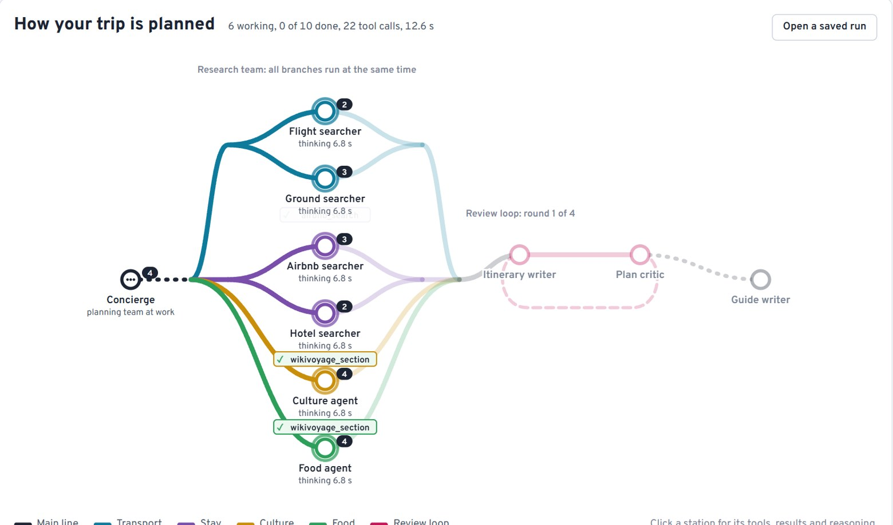

# Multi-Agent Travel Planner

Tell it where and when you want to travel. Thirteen AI agents then work together to produce a day-by-day trip
guide:

- they compare flights, ferries and trains, and Airbnb against hotels;
- they find sights with their history, local dishes and restaurants for your budget;
- they fit everything into a schedule that respects opening hours and the weather;
- a critic checks the result, and you approve the reviewed plan before the guide is written;
- when you ask for a change ("a cheaper hotel", "a slower pace"), the concierge decides which research to redo
  and the rest is reused.

The planner never books anything. Every option comes with a link, and every price says where it came from.

Built with [Google ADK](https://google.github.io/adk-docs/) on GPT OSS 120B (University of Oulu Lehmus API) for the
AI Engineering course. See [PROJECT.md](PROJECT.md) for the specification and [PLAN.md](PLAN.md) for the build log
and decisions.



**Example request:** *"Plan 5 days in Lisbon for two, mid budget, we love history and street food."* About seven to nine
minutes later you get `output/lisbon-2027-05-10-to-2027-05-14.md` and `.html` with:

- the chosen flights and their alternatives;
- stays compared by neighbourhood;
- five planned days with short histories and food stops;
- the dishes to try;
- a cost table against your budget, with sources marked as *live* or *web estimate*;
- warnings where something needs your attention, such as a cheap flight that costs you most of the last day.

---

## Quick start: the offline demo (no keys needed)

A complete Lisbon run is recorded in `cache/demo/`: every tool result and every model answer. With `DEMO=1`
the planner replays it exactly, so you can see the whole system without any accounts. After installing, it needs
no network either.

You need Python 3.11 or newer (developed on 3.13) and Git.

```bash
git clone <this repository> && cd Multi-Agent-Travel-Planner
python -m venv .venv
.venv/Scripts/pip install -r requirements.txt     # macOS/Linux: .venv/bin/pip
```

Then pick one of three ways to watch it:

| How | Command | What you see |
|---|---|---|
| Terminal | `.venv/Scripts/python scripts/run_trip.py --demo` | The conversation, every tool call, an agent timeline and the quality checks, in about 3 s |
| ADK web | `DEMO=1 .venv/Scripts/adk web`, then pick `travel_planner` | ADK's chat UI with the full event trace |
| Web UI | `.venv/Scripts/python scripts/serve.py --demo`, then open http://localhost:8000 (needs Node.js 18+ for the first build) | The animated agent map, inspector, timeline and guide |

In `adk web` and the web UI, type (or click) exactly these eight messages, because the replay only knows the
recorded conversation (they are listed in `travel_planner/demo_script.py`):

1. `Plan 5 days in Lisbon for two, mid budget, we love history and street food.`
2. `We fly from Helsinki, 10-14 May. Total budget about 2500 euros.`
3. `Yes, that's right, go ahead.` (planning starts; the reviewed plan is shown for approval)
4. `Looks good, please write the guide.`
5. `Thanks! Which day do we visit Belém, and what does the tower cost?`
6. `Could we take it a bit slower, with a relaxed pace, and stay somewhere cheaper?`
7. `Yes, please do that.` (the concierge re-plans: only the stay is researched again)
8. `Looks good, please write the guide.`

Any other message gets `LLM_CACHE_MISS`: the replay has no model to answer it.

In PowerShell, set variables first: `$env:DEMO="1"; .venv\Scripts\adk web`. Add `DEMO_PACE=0.2` to replay the
model answers at a realistic speed (about 2 minutes for the whole run) instead of instantly.

## The web UI

A React front end in [`travel-planner-ui/`](travel-planner-ui/README.md):

- **Chat** with the concierge.
- **Route map:** the agent tree drawn as a transit map. Stations light up while agents think, tool calls rise
  out of them as chips, and the review loop counts its rounds.
- **Inspector:** click any agent or tool call for its arguments, results and reasoning.
- **Activity:** a Gantt chart of who worked when.
- **Approval:** the reviewed plan appears in the chat with "Approve and write the guide" and "Request changes".
- **Cost and time:** model answers, tokens, tool calls and working time per agent, and which research a re-plan
  reused.
- **Guide:** the rendered guide, with downloads: Markdown, HTML, the calendar (`.ics`) and the map (`.geojson`).
- **Replay:** recorded runs, with play, pause and speed controls.

One command starts the planner and the UI together. It builds the UI on first start, which needs Node.js 18+:

```bash
.venv/Scripts/python scripts/serve.py --demo     # the recorded demo -> http://localhost:8000
.venv/Scripts/python scripts/serve.py            # live planning (see the next section)
```

"Watch a recorded run" in the UI needs no API server at all. For UI development with hot reload, see
[travel-planner-ui/README.md](travel-planner-ui/README.md).


---

## Plan your own trip (live)

This is how to run the planner for real on your own computer and ask for any trip: any city, your dates, your
budget. Setup takes about 15 minutes; each plan then takes 7 to 9 minutes.

### 1. Install

- Python 3.11+ and Git; Node.js 18+ (for the web UI and Airbnb search). Then, in the project folder:

  ```bash
  python -m venv .venv
  .venv/Scripts/pip install -r requirements.txt        # macOS/Linux: .venv/bin/pip
  ```

### 2. Configure `.env`

Copy `.env.example` to `.env` and fill it in. Only the first two rows are required; every missing key has a
fallback, so the planner still finishes, with less detail.

| Setting | Needed | Without it |
|---|---|---|
| `LEHMUS_API_BASE`, `LEHMUS_API_KEY` (GPT OSS 120B; the model id is preset) | **required** | No planning. Lehmus works only on the University of Oulu network or VPN. Off the VPN, set `LLM_MODEL` and `LLM_API_KEY` for another provider, e.g. `openai/gpt-4.1-mini` through LiteLLM. Untested: the prompts were tuned on GPT OSS 120B |
| `CONTACT_EMAIL` | **required in practice** | Wikipedia, Wikivoyage and Nominatim block clients without a contact address (HTTP 403), so sights, dishes and geocoding get weaker |
| `TAVILY_API_KEY` ([tavily.com](https://tavily.com), free 1,000/month) | recommended | No opening hours or ticket prices from the web; ferry and bus fares stay unknown |
| `OPENTRIPMAP_API_KEY` ([dev.opentripmap.org](https://dev.opentripmap.org), free) | recommended | Sights come from Wikivoyage only |
| `LITEAPI_KEY` ([liteapi.travel](https://www.liteapi.travel), free sandbox) | optional | Hotels from SerpApi only, or Booking.com search links without prices |
| `SERPAPI_KEY` ([serpapi.com](https://serpapi.com), free ~250/month) | optional | Hotels from liteAPI only; flight fallback uses the fast-flights library |

Flights (Kiwi.com MCP), Airbnb (MCP), weather, trains and ferries, maps and Wikipedia need no key.

### 3. Check the setup

```bash
.venv/Scripts/python scripts/check_setup.py
```

It makes one tiny LLM request, checks every key and service, and says what each missing piece costs. It ends with
"Ready" or "Not ready" (exit code 1), for example:

```
[ok  ] LLM                          openai/azsydsttjnlbfjbgqnwd answered in 0.6 s ('OK')
[warn] TAVILY_API_KEY               not set: no opening hours or ticket prices from the web, ...
[ok  ] Kiwi.com MCP (flights)       reachable (HTTP 200)
Ready, with 1 warning(s): the planner works, and the features above fall back as described.
```

### 4. Start it

```bash
.venv/Scripts/python scripts/serve.py              # opens http://localhost:8000
```

Options:
- `--port 8080`;
- `--host 0.0.0.0` to reach it from other devices on your network. It has no login, so only do this on a
  network you trust;
- `--no-browser`;
- `--rebuild-ui` after changing the UI.

Stop it with Ctrl+C. Without Node.js, use ADK's own chat UI instead: `.venv/Scripts/adk web`, then pick
`travel_planner`.

### 5. Ask for a trip

Write your request in your own words. The concierge asks for anything missing, then shows a summary. Planning
starts only after you confirm it. You can add hard requirements such as "we don't fly", "travelling with a
4-year-old" or "vegetarian". If you need no accommodation ("we stay in our own apartment"), no stay is searched,
planned or costed. If you drive your own car ("I will use my car"), no flights, trains or buses are searched; a
car ferry is planned when the route crosses the sea, and the guide gives a rough road distance and time. Fuel or
charging, tolls and parking are not estimated (they depend on the car). The planner handles one city for up to 21 days. For example:

> 4 days in Barcelona for two from Helsinki, 2-5 June 2027, mid budget, about 1800 euros. We like Gaudí
> architecture, art museums and tapas.

Then:
- Watch the agents work on the map; it takes 7 to 9 minutes.
- The reviewed plan appears in the chat. Approve it, or say what to change.
- The guide opens in the **Guide** tab, and is saved as Markdown and HTML in `output/`, with a calendar file
  (`.ics`, one event per planned item) and a map file (`.geojson`, the planned places in order).
- Ask follow-up questions in the same chat. They are answered from the guide.
- To change the plan, say so. The concierge decides which research the change needs: "a cheaper hotel" redoes
  only the stay search, "start the days at 8" or "a slower pace" skips the research and only re-plans the days
  (research is 1.5 to 2.5 minutes of a plan; the planner and the review always run again). A new city, new dates, another origin or another group size is a new trip and is
  researched from scratch.
- **New conversation** starts over.

Without the UI, a scripted trip runs in the terminal: `.venv/Scripts/python scripts/run_trip.py --trip tallinn`
(trips: `lisbon`, `tallinn`, `rome`, `krakow`).

### How it behaves

- **It never books.** Every flight, stay and sight comes with a link. Prices are marked *live* (quoted by the
  booking source) or *web estimate*.
- **Warnings:** the guide opens with an **Important** note when your travel times cost most of a day, and names
  the option that would keep it. Anything the final check could not fix is listed under "Still to check".
- **Prices in other currencies** (Kraków, Prague, London) are converted to euro.
- **Caching:** API answers are saved under `cache/` (live prices for a day at most), so a second plan for the same city
  is faster and uses less free-tier quota. Delete `cache/` (but not `cache/demo/`) to fetch everything fresh.
- **Failures:** a failing source does not stop the plan. Each agent has fallbacks, and the guide's
  "Good to know" section lists what was missing.
- **Waiting:** a plan takes 7 to 9 minutes (12 to 18 when several plans run at once). The map shows what is
  happening.

### Troubleshooting

| Symptom | Fix |
|---|---|
| `check_setup.py`: LLM FAIL, timeout or connection error | Connect to the University of Oulu VPN (Lehmus), or set `LLM_MODEL` / `LLM_API_KEY` |
| The UI says "Planner server not running" | Start `scripts/serve.py` (or `adk api_server .` for the dev UI) and click "Try again" |
| `npm was not found` when starting | Install Node.js 18+, or use `.venv/Scripts/adk web` |
| Port 8000 already in use | `scripts/serve.py --port 8080` |
| Sights or dishes are thin; HTTP 403 in the setup check | Set `CONTACT_EMAIL` in `.env` |
| No Airbnb listings | Node.js/npx is missing, or Airbnb blocked the request; hotels still work |
| Ferry or train times say "TYPICAL TIMETABLE" | The trip is beyond the published timetables; times come from the same weekday on a nearer date. Check them before booking |

---

## Architecture

```mermaid
flowchart LR
    U([You]) <--> C["concierge<br/><i>geocode_place, save_trip_brief,<br/>request_replan, approve_plan</i>"]
    C -- "brief confirmed, or a re-plan<br/>with the concierge's scope" --> P
    P -- "reviewed plan<br/>shown for approval" --> U
    C -- "plan approved:<br/>approve_plan" --> GW["guide_writer<br/><i>save_guide, export_calendar,<br/>export_map_stops</i>"]

    subgraph P["planning_pipeline (sequential)"]
        direction LR
        subgraph R["research_team (parallel; a re-plan skips the branches out of scope)"]
            direction TB
            subgraph T["transport_team"]
                direction LR
                subgraph TS["transport_search (parallel)"]
                    F["flight_searcher<br/><i>Kiwi MCP, Google Flights</i>"]
                    G["ground_searcher<br/><i>Transitous, web search</i>"]
                end
                TC["transport_comparer"]
                TS --> TC
            end
            subgraph S["stay_team"]
                direction LR
                subgraph SS["stay_search (parallel)"]
                    A["airbnb_searcher<br/><i>Airbnb MCP</i>"]
                    H["hotel_searcher<br/><i>liteAPI, Google Hotels</i>"]
                end
                SC["stay_comparer"]
                SS --> SC
            end
            CU["culture_agent<br/><i>OpenTripMap, OSM hours,<br/>Wikipedia, Wikivoyage</i>"]
            FO["food_agent<br/><i>Wikidata dishes, Overpass,<br/>Wikivoyage</i>"]
        end
        IP["itinerary_planner<br/><i>weather, clustering, cost</i>"]
        subgraph L["review_loop (loop, max 3 rounds)"]
            direction LR
            BC["plan_critic<br/><i>check_itinerary, cost</i>"] --> IR["itinerary_reviser<br/><i>exit_loop,<br/>extra_sights_researcher (agent as tool)</i>"]
            IR -. "REVISE" .-> BC
        end
        R --> IP --> L
    end
    GW --> O[("output/*.md, *.html,<br/>*.ics, *.geojson")]
```



The agents share their results through ADK session state. Each one writes one key that later agents read in
their instructions:

| Agent | Writes | Reads |
|---|---|---|
| concierge | `trip_brief` (via `save_trip_brief`), `replan_scope` (via `request_replan`) | the chat; the reviewed plan or the finished guide |
| flight / ground / airbnb / hotel searcher | `flight_options`, `ground_options`, `airbnb_options`, `hotel_options` | `trip_brief` |
| transport / stay comparer | `transport_summary`, `stay_summary` | the two searchers' options |
| culture / food agent | `culture_findings`, `food_findings` | `trip_brief` |
| itinerary_planner | `itinerary` | the four summaries and findings |
| plan_critic | `critique` (ends with `VERDICT: APPROVED` or `REVISE`) | `itinerary`, summaries |
| itinerary_reviser | `itinerary` (revised); new sights into `culture_findings` | `itinerary`, `critique`, the code check, all research |
| extra_sights_researcher (a tool of the reviser) | `extra_sights_findings` | the area the reviser asks about, `culture_findings` |
| guide_writer | `final_guide` (via `save_guide`), `guide_reply`, calendar and map files | everything above |

**Orchestration patterns:**
- *Coordinator with delegation:* the concierge collects the brief and transfers to the pipeline, and after your
  approval to the guide writer.
- *Sequential:* the pipeline, and each team's search-then-compare.
- *Parallel:* four research branches, two of which nest a parallel search.
- *Loop:* critic and reviser until approval, at most three rounds.
- *Agent as tool:* the reviser calls `extra_sights_researcher`, a second culture researcher wrapped in an ADK
  `AgentTool`, when a day is thin and nothing researched is left nearby.
- *Human in the loop:* the pipeline stops after the review; you approve the plan or ask for a change.

### Who decides what

The agents make the choices; code checks objective facts, may refuse an unsafe action with a reason, and logs
every time it overrides an agent (`review_log`, `revision_log`, `replan_log`, `extra_sights_log`), so
`scripts/evaluate.py` can count how often that happens.

| Decision | Made by | Code's part |
|---|---|---|
| Search parameters, tools, fallbacks, rankings | each research agent | tool budgets; links must come from tool results |
| Which research a change needs (re-plan scope) | **concierge** (`request_replan`) | refuses a new destination, dates, origin or group, a changed "no flights" without transport, or no finished plan to reuse; without a request, everything is researched again |
| Whether the guide is written | **you**, read by the concierge (`approve_plan`) | refuses when no reviewed plan is waiting |
| The day-by-day schedule | itinerary planner | recomputes travel times, tickets and the cost from the plan |
| Whether to research a thin day further | **reviser** (`extra_sights_researcher`) | at most 2 calls per round; new sights are grounded and merged into the research |
| How to fix a review | reviser | undoes a broken or worse revision; `exit_loop` only after approval |
| Taste: interests, rainy days, order within a day | critic | none |
| Day shape: an empty morning, two meals close together, a placeholder meal, an empty afternoon | **critic**: fixes each one, or declines it under DECLINED with a reason about this trip | reports them ("decide"); a finding the critic leaves out, or declines with a stock phrase ("fine", "minor"), must be fixed; obvious cases stay must-fix (a late start although that day's own sights open in the morning, two meals under 2 hours apart); every decline is logged |
| Verdict | critic | overrules the critic on facts (closed hours, invented places or prices, over budget with a cheaper option, wrong day count, a refused transport mode, items outside the hours the travellers stated) and stops rounds that cannot help; every override is logged with what the critic said |
| Last chat message (rhythm offer) | code (`finish_guide`), a fixed sentence | |

**Code guards around the model.** Live runs showed GPT OSS breaking prompt rules: it copied the wrong flight's
times, changed URLs, turned unknown prices into "free", and approved plans with closed museums. The rules that
matter are therefore enforced in code, each with a regression test:

| Guard | Module | What it guarantees |
|---|---|---|
| Confirmation | `agents/concierge.py` | The brief is checked, saved only after you confirm what you saw, and only then does planning start |
| Re-plan scope | `agents/replan.py` | The concierge's scope is only used when it is safe for the brief that was saved; skipped branches keep their results unchanged |
| Approval | `agents/approval.py` | The guide is written only after you approved a reviewed plan |
| Hard requirements | `tools/trip.py`, `agents/transport.py`, `agents/stay.py` | An excluded transport mode is never searched or chosen; with no accommodation needed the stay team does not run and a planned stay is removed; with their own car no flight is searched, a planned flight, train or bus is removed, and a car ferry the routing tool found is kept (driving over the sea is must-fix); other requirements reach every agent |
| Grounded links | `agents/grounding.py` | Every link shown comes from a tool result; altered links are restored, invented ones removed |
| Itinerary tidy | `agents/itinerary_tidy.py`, `agents/enrich.py` | Travel times come from the chosen transport, tickets and hours from the research; the cost is recomputed from the plan |
| Review checks | `agents/review_checks.py`, `agents/plan_critic.py` | Code checks the budget, opening hours, grounding, day count and pacing; facts are must-fix, day-shape matters of taste go to the critic, who must decide each one |
| Guide check | `agents/guide_writer.py` | Before saving, the guide is compared with the checked plan; travel-time warnings and open problems are added |
| Revision guards | `agents/itinerary_reviser.py`, `agents/extra_sights.py` | `exit_loop` only after approval; broken or worse revisions are undone; on-demand research is budgeted and grounded |
| Retries and budgets | `agents/retry.py`, `agents/limits.py` | A tool call with invalid JSON gets two more tries; tool budgets are enforced so free quotas last |

## Tools and data sources

Twenty-four function tools, one agent used as a tool, and two MCP servers. Every tool returns `{"status": "ok", "results": [...]}` or
`{"status": "error", "reason": ...}`; tools never raise to the agent, and each research agent has fallbacks.

| Tool | Source | Agent |
|---|---|---|
| Kiwi `search-flight` (MCP, remote HTTP) | Kiwi.com | flight_searcher |
| `search_google_flights`, `search_serpapi_flights` | Google Flights (fast-flights, SerpApi) | flight_searcher (fallbacks) |
| `plan_public_transport` | Transitous (MOTIS); a typical timetable for dates beyond the published ones | ground_searcher |
| Airbnb `airbnb_search` (MCP, local `npx`) | Airbnb | airbnb_searcher |
| `search_hotel_rates`, `search_google_hotels`, `stay_deep_links` | liteAPI, SerpApi Google Hotels, Booking/Airbnb search links | hotel_searcher |
| `find_sights`, `find_sight_hours`, `wiki_summary`, `wikivoyage_section` | OpenTripMap, OpenStreetMap, Wikipedia, Wikivoyage | culture_agent |
| `local_dishes`, `find_restaurants` | Wikivoyage + Wikidata, OpenStreetMap (Overpass) | food_agent |
| `web_search` | Tavily | culture, food, ground agents |
| `geocode_place` | Nominatim, with Open-Meteo geocoding as fallback | concierge, research agents |
| `get_forecast` | Open-Meteo (forecast, or the same dates last year) | itinerary_planner |
| `cluster_by_distance`, `calculate_trip_cost`, `check_itinerary` | own code | planner, critic |
| `save_trip_brief`, `request_replan`, `approve_plan` | own code | concierge |
| `save_guide`, `export_calendar`, `export_map_stops` | own code | guide_writer |
| `exit_loop`; `extra_sights_researcher` (an `AgentTool` around a culture researcher) | ADK; OpenTripMap, OpenStreetMap, Wikipedia | itinerary_reviser |

## Requirements checklist

| Requirement (PROJECT.md §7) | Where it is met |
|---|---|
| At least 3 different agents | 13 LLM agents with distinct roles and prompts in `travel_planner/agents/`, plus 7 workflow agents; `tests/test_agents.py::test_root_agent_tree` checks the tree |
| Multi-agent orchestration pattern | Delegation (`concierge.py`), sequential, parallel, nested parallel (`teams.py`, `pipeline.py`), loop (`pipeline.py::build_review_loop`), agent as tool (`extra_sights.py`) and human in the loop (`approval.py`) |
| At least one tool call | 24 function tools in `travel_planner/tools/`, `agents/review_checks.py`, `agents/replan.py` and `agents/approval.py`, an agent used as a tool (`agents/extra_sights.py`) and 2 MCP servers (`tools/mcp.py`); the demo makes 55 tool calls |
| Fully agentic | Agents make the choices between steps too: the concierge decides which research a change needs (`request_replan`) and when you approved the plan (`approve_plan`); the reviser decides when to research more (`extra_sights_researcher`). Code checks facts, refuses unsafe actions with a reason and logs every override; see "Who decides what" and the evaluation below |
| No code from assignments 2 and 3 | New repository written from scratch (see the git history) |
| Executable, no errors | 435 offline tests (`pytest`, including an end-to-end replay of the demo that must have no cache miss) and 11 UI tests (`npm test`). Four test trips pass live (PLAN.md, Phase 9), plus a custom trip through `scripts/serve.py` and a trip with no data-source keys (Phase 10b). `scripts/check_setup.py` checks a new machine. The recorded demo replays offline with `scripts/run_trip.py --demo` |

## Tests

```bash
.venv/Scripts/python -m pytest            # 435 offline tests, ~6 s: tools on recorded responses, agents, guards, the demo replay
.venv/Scripts/python -m pytest -m live    # hits the real APIs and re-records tests/fixtures/cache
cd travel-planner-ui && npm test          # UI layout and event reducer, checked against the recorded demo
```

The offline tests also run the review loop, the retry, the concierge's hand-overs, the change router, the approval
step and research on demand on scripted models, so no LLM is needed. `tests/test_demo_replay.py` replays the
recorded demo end to end in a temporary output folder and fails on any LLM cache miss.

## Evaluation

`scripts/evaluate.py` measures finished runs offline from the saved session state and metrics
(`output/runs/<trip>-state.json` and `-metrics.json`, written by `scripts/run_trip.py`):

```bash
.venv/Scripts/python scripts/evaluate.py                    # every run in output/runs
.venv/Scripts/python scripts/evaluate.py --agents           # + tokens, tool calls and seconds per agent
.venv/Scripts/python scripts/evaluate.py --judge            # + LLM-as-judge scores 1-5 (live LLM)
CRITIC_MODE=code_only RUN_LABEL=code_only .venv/Scripts/python scripts/run_trip.py --trip krakow   # ablation
```

Runs of 2026-11-19 (GPT OSS 120B). "A4" columns ran after the day-shape findings became the critic's decision;
the columns without a label ran before, when code enforced them. The demo column is the recording replayed (its
times are replay times, and the state is the second plan's). "code only" is the ablation.

| Measure | lisbon (demo, 2nd plan) | tallinn | rome | krakow | tallinn (A4) | rome (A4) | krakow (A4) | tallinn (code only) | krakow (code only) |
|---|---|---|---|---|---|---|---|---|---|
| Review rounds | 2 | 3 | 3 | 2 | 1 | 3 | 2 | 1 | 2 |
| Final verdict | APPROVED | APPROVED | REVISE | APPROVED | APPROVED | REVISE | APPROVED | APPROVED | APPROVED |
| Critic mode | llm | llm | llm | llm | llm | llm | llm | code_only | code_only |
| Critic = code verdict (rounds) | 1/2 | 3/3 | 3/3 | 1/2 | 0/1 | 3/3 | 2/2 | 1/1 | 2/2 |
| Code overrides | r2: critic REVISE -> APPROVED | none | none | r2: critic REVISE -> APPROVED | r1: critic REVISE -> APPROVED | none | none | none | none |
| Must/should per round | 4/5 → 0/1 | 1/1 → 1/1 → 0/1 | 8/10 → 2/4 → 3/4 | 2/1 → 0/1 | 0/0 | 2/6 → 1/6 → 3/2 | 0/1 → 0/1 | 0/1 | 0/3 → 0/1 |
| Day-shape findings to decide per round | 0 → 0 | - → - → - | - → - → - | - → - | 0 | 3 → 0 → 0 | 1 → 0 | - | - → - |
| Declined by the critic (with a reason) | 0 | 0 | 0 | 0 | 0 | 0 | 0 | 0 | 0 |
| Declines refused by code (stock reason) | 0 | 0 | 0 | 0 | 0 | 0 | 0 | 0 | 0 |
| A decline, as written | - | - | - | - | - | - | - | - | - |
| Final plan must/should (code check) | 0/1 | 0/1 | 0/2 | 0/1 | 0/0 | 1/5 | 0/1 | 0/1 | 0/1 |
| Revisions undone by code | 1 | 0 | 0 | 1 | 1 | 1 | 0 | 0 | 0 |
| Planned places found in research | 6/6 | 10/10 | 27/27 | 11/11 | 12/12 | 20/20 | 11/11 | 11/11 | 16/16 |
| Links removed (invented) | 1 | 1 | 1 | 2 | 3 | 1 | 1 | 0 | 10 |
| Budget EUR | 2500.0 | 450.0 | - | 900.0 | 450.0 | - | 900.0 | 450.0 | 900.0 |
| Computed total EUR | 1532.0 | 585.0 | 2624.0 | 755.44 | 420.8 | 2692.0 | 986.9 | 429.3 | 955.0 |
| Sights researched on demand | 0 | 0 | 9 | 0 | 4 | 7 | 0 | 0 | 0 |
| Re-plans (agent's scope) | rerun ['stay'] | none | none | none | none | none | none | none | none |
| Re-plan requests refused | 0 | 0 | 0 | 0 | 0 | 0 | 0 | 0 | 0 |
| Seconds (whole chat) | 0.5 | 247.7 | 605.8 | 304.2 | 325.0 | 536.5 | 262.5 | 149.2 | 272.3 |
| Seconds saved by reusing research | 0.1 | - | - | - | - | - | - | - | - |
| Tool calls | 54 | 30 | 45 | 39 | 31 | 41 | 36 | 22 | 35 |
| Tokens (prompt + output) | 957931 | 457625 | 788149 | 594039 | 455850 | 716807 | 581155 | 279703 | 525569 |
| LLM cache misses | 0 | 0 | 0 | 0 | 0 | 0 | 0 | 0 | 0 |

What the numbers say:
- **Grounding holds:** every planned place in every run is in the research. Links the model invented are removed
  (0 to 10 per run). All final plans but one have no must-fix problem left; Rome (A4) ended its three rounds with a
  place used twice, which the guide lists under "Still to check".
- **Who decides the verdict:** code overrode the critic 3 times in these runs, always to approve when the critic
  wanted another round that could not help (no must-fix problem left, and the last round or no progress). It never
  had to turn a critic's approval into REVISE. Code undid 4 revisions (a plan changed after approval).
- **Day shape is the critic's call (A4):** in the A4 runs the check gave the critic 4 day-shape findings to decide
  (3 in Rome, 1 in Kraków); it chose to fix all 4, declined none, and code refused no decline. So handing these
  findings to the critic did not bring back the lunch-first days seen earlier; the guards (silence and stock
  phrases count as "fix it", obvious cases stay must-fix) were not needed in these runs but are covered by tests.
- **Research on demand:** the reviser called `extra_sights_researcher` on its own in Rome (9 and 7 new sights) and
  Tallinn (4).
- **Change router:** in the demo the concierge scoped "a relaxed pace and a cheaper stay" to `rerun: ["stay"]`.
  Live, the stay research took 54 s against 88 to 154 s for a full research phase (Lisbon 119 s), so the change
  saved about a minute of research; the planner and the review (2 to 5 minutes) run again on every re-plan.
- **Ablation:** with `CRITIC_MODE=code_only` the loop needs fewer rounds (Tallinn 1 vs 3) because the code check
  approves a plan whose remaining problems are should-fix only, without the critic's judgement of interests,
  rainy days and order. (The Tallinn ablation's scripted chat ended before the approval step: the concierge asked
  for confirmation one turn later, so no guide was written.)
- **Variance:** the same script can take another turn live. In a live Lisbon run the concierge asked for a nightly
  price cap before re-planning, which the scripted replies never gave, so no re-plan happened.

## Project layout

```
travel_planner/           the ADK app (adk web lists it as "travel_planner")
  agent.py                root_agent
  config.py               model, cache, demo mode
  llm_cache.py            LLM answer cache for the demo
  models.py               shared Pydantic models (TripBrief, TransportOption, StayOption, Place)
  agents/                 agent builders, prompts and the code guards
  tools/                  function tools, HTTP cache, MCP toolsets
travel-planner-ui/        React web UI (see its README)
scripts/                  serve.py (start everything), check_setup.py, run_trip.py, demo and replay tools
tests/                    pytest suite and recorded fixtures
cache/demo/               the recorded Lisbon demo (committed); other cache/ folders are local only
output/                   generated guides (not committed)
docs/                     DEMO.md (presentation script) and screenshots
```

## Limitations

- **Speed:** a live run takes 7 to 9 minutes on its own and 12 to 18 minutes when five run at once (stress test,
  19 Nov 2026); the model's answers are the bottleneck, and the comparers wait for the slowest searcher.
  A change to a finished plan is faster when the concierge reuses research, but only as fast as the slowest
  branch it reruns.
- **Thin days:** long trips can get thin days. The reviser can research an area on demand (at most twice per
  review round); if that finds nothing new, code approves the thin day.
- **Change scope is the concierge's judgement:** code refuses unsafe scopes (a new city, dates, origin or group;
  a new "no flights" without transport), but a scope that is too narrow for a matter of taste (e.g. new interests
  without culture) is not caught.
- **Prices:** prices are quotes or estimates, never bookings. *Web estimate* fares come from web pages and can be
  out of date. Hotel sandbox rates can differ from public prices.
- **Typical timetables:** for trips months ahead, ferry and train times come from a "typical timetable" (the same
  weekday on a nearer date) and are labelled so in the guide.
- **Demo is fixed:** the demo replays only the recorded conversation. Re-record it after changing any prompt,
  tool output or check (needs the Lehmus LLM): `scripts/record_demo.py`, then `scripts/prune_demo_cache.py
  --delete`, `scripts/record_ui_replay.py` and the facts pinned in `travel-planner-ui/src/lib/run.test.ts`.
- **Rate limits:** Nominatim rate-limits busy IPs; geocoding then falls back to Open-Meteo.
- **One city, up to 21 days:** for a region ("Tuscany") or several cities, the concierge asks you to pick one city.
- **Hard requirements:** "no flights" is enforced in code; needs such as diet or children are followed by the
  agents but not checked.

## Data and licences

Map and place data © OpenStreetMap contributors (ODbL). Weather and geocoding by Open-Meteo (CC BY 4.0). Routing by
[Transitous](https://transitous.org/sources/). Sights © OpenTripMap. Texts from Wikipedia and Wikivoyage
(CC BY-SA 4.0). Dishes from Wikidata (CC0). Flight data from Kiwi.com, stays from Airbnb, liteAPI and Booking.com
links. Exchange rates from the European Central Bank via [Frankfurter](https://frankfurter.dev). Every guide ends
with this attribution.

Code: MIT licence, see [LICENSE](LICENSE).
